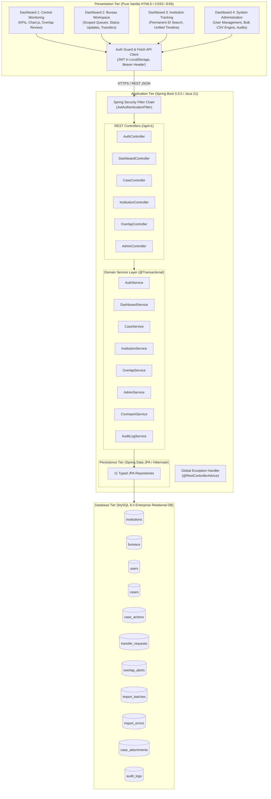

# EduVision – Complaint Monitoring Portal

A centralized AICTE dashboard for tracking institution-related complaints across the Regulation Bureau, PGRC, and other cells. It brings case status, ownership, action history, and reports together, while flagging potential overlaps and deadline risks to help officials coordinate effectively and resolve grievances on time.

> **Transparent • Responsive • Better Education**  
> Full-Stack Technical Education Grievance Redressal and Institutional Monitoring Portal pursuant to All India Council for Technical Education (AICTE) regulations.

---

## Visual Fidelity to Reference Dashboard
This implementation faithfully recreates the **EduVision Dashboard** design:
- **Top Navigation Bar**: Deep navy header (`#0C2B4E`), EduVision logo, global search bar, notification bell with unread badge (`3`), and user profile avatar with dropdown.
- **Left Sidebar**: Dark navy navigation (`#07172C`), active item highlighting in royal blue (`#1D4ED8`), lower section with glowing building artwork ("Your Voice Matters") and official AICTE emblem.
- **Hero Banner**: High-resolution modern campus facade with blue gradient, quote card (`"Better Governance for Quality Technical Education" — AICTE`), and dynamic role indicator.
- **3 Primary Action Cards**: Soft pastel cards for *File a New Complaint* (sky blue), *Track Your Complaint* (mint green), and *View Guidelines* (lavender).
- **5 Dynamic Metric Cards**: *Total Complaints* (3), *In Process* (1, 33%), *Resolved* (1, 33%), *Rejected* (0, 0%), and *Under Review* (1, 33%) with formatted timestamps.
- **Recent Complaints Table**: Exact rows (`CMP-2026-000103` to `CMP-2026-000099`), formatted dates, institutions, categories, colored status badges, and action buttons.
- **Right Support Panels**: *Quick Links*, *Need Help?* (toll-free, email, live chat with support illustration), and *Who Can File a Complaint?*.
- **Bottom Process Banner**: Horizontal 4-step workflow connected with chevrons and student illustration ("Together for Better Education").
- **Footer**: AICTE portal branding, legal links, and copyright text.
# EduVision — AICTE Integrated Institution Complaint Monitoring & Status Dashboard

[](#)
[](#technology-stack)
[](#security-architecture)

> **EduVision:** A centralized AICTE dashboard for tracking institution-related complaints across the Regulation Bureau, PGRC, and other cells. It brings case status, ownership, action history, and reports together, while flagging potential overlaps and deadline risks to help officials coordinate effectively and resolve grievances on time.  
> **System Architecture:** Unified National Grievance Monitoring Platform  
> **Target Audience:** All India Council for Technical Education (AICTE) Headquarters, Regional Offices, Senior Authority / Central Monitoring Officials, Bureau Officers (`RB`, `PGRC`, `APPROVAL`, `POLICY`), and System Administrators.

---

## Table of Contents
1. [Executive Summary & Problem Statement](#executive-summary--problem-statement)
2. [System Architecture](#system-architecture)
3. [Technology Stack](#technology-stack)
4. [Exactly Four Main Dashboards](#exactly-four-main-dashboards)
5. [Database Design & Normalization (3NF)](#database-design--normalization-3nf)
6. [Security & Role-Based Access Control (RBAC)](#security--role-based-access-control-rbac)
7. [Getting Started & Installation Guide](#getting-started--installation-guide)
8. [Demo Credentials](#demo-credentials)
9. [National System Walkthrough Guide](#national-system-walkthrough-guide)
10. [Technical Specifications & Architecture Details](#technical-specifications--architecture-details)
11. [REST API Documentation Catalog](#rest-api-documentation-catalog)
12. [Project Directory Layout](#project-directory-layout)

---

## Executive Summary & System Objectives

### The Background & Operational Need
Technical institutions across India receive thousands of complaints spanning varied jurisdictions — from infrastructural violations and faculty cadre shortages handled by the **Regulation Bureau (RB)** to capitation fee extortions and degree retention investigated by the **Public Grievance Redressal Cell (PGRC)**. 

Historically, AICTE bureaus have operated in organizational silos. This fragmented ecosystem leads to:
1. **Blind Overlaps:** Multiple bureaus independently investigating the same institution on divergent complaints without cross-bureau visibility.
2. **Untracked Transfers:** Case jurisdiction transfers between bureaus handled via informal correspondence, losing historical accountability.
3. **Audit Vulnerabilities:** Case status modifications lacking chronological, append-only remarks and user attribution.
4. **Data Ingestion Friction:** Bulk CSV intakes failing silently or introducing orphan records into national registers.

### The Solution: Integrated Monitoring & Status Dashboard
This enterprise platform delivers a **centralized, non-public, high-security internal dashboard** engineered to provide end-to-end institutional visibility:
- **Permanent ID Unification:** Every complaint is strictly linked to a verified AICTE Permanent ID (e.g., `1-1097234567`).
- **Real-Time Cross-Bureau Overlap Detection:** Automatically flags when multiple bureaus have concurrent active cases on the same institution without destructive merging.
- **Append-Only Chronological Case History:** Every status transition, remark, and action item creates an immutable timestamped log.
- **Controlled Inter-Bureau Jurisdiction Transfers:** Formal transfer requests reviewed and authorized centrally, strictly preserving internal Case IDs.
- **Pre-Import Validated Bulk Ingestion:** Dry-run CSV validation engine isolating invalid institution IDs, corrupted bureau codes, and missing mandatory headers.
- **Role-Based Scoped Authorization:** Spring Security JWT enforcement preventing bureau officers from inspecting or modifying foreign bureau workloads.

---

## System Architecture



---

## Technology Stack

### Frontend
- **HTML5 & CSS3**: Native CSS Grid and Flexbox layouts.
- **Vanilla JavaScript (ES6+)**: Pure, framework-free JavaScript with Fetch API integration.
- **Icons**: Font Awesome 6.5.1 CDN.
- **Strict File Separation**: Separate HTML, CSS, and JS files for each functional area.

### Backend
- **Java**: Java 21 LTS / Java 25.
- **Spring Boot 3.2.5**:
  - `spring-boot-starter-web`: Versioned REST APIs (`/api/v1`).
  - `spring-boot-starter-data-jpa`: Hibernate ORM and repository layer.
  - `spring-boot-starter-security`: Stateless JWT authentication and role-based access control.
  - `spring-boot-starter-validation`: Bean validation for DTOs.
  - `springdoc-openapi-starter-webmvc-ui`: Swagger 3 interactive API testing.
- **Security**: BCrypt password hashing, signed JWT tokens, CORS policy, strict ownership validation.

### Database
- **MySQL 8.x**: Production relational schema with normalized tables, foreign keys, and indexes.
- **H2 Database**: Out-of-the-box development profile with MySQL dialect compatibility for instant zero-dependency testing.
- **Schema & Seed Scripts**: `database/schema.sql` and `database/seed-data.sql`.

---

## Project Structure

```text
EduVision/
├── frontend/
│   ├── index.html                 # Primary Dashboard matching reference
│   ├── login.html                 # User authentication
│   ├── register.html              # Role registration
│   ├── file-complaint.html        # Complete grievance submission form
│   ├── my-complaints.html         # User grievance list with filters & pagination
│   ├── track-complaint.html       # Public grievance tracking by ID
│   ├── complaint-details.html     # Deep dive into grievance & timeline
│   ├── profile.html               # Profile & password change
│   ├── guidelines.html            # Redressal guidelines & searchable FAQs
│   ├── support.html               # Contact helpdesk form
│   ├── admin-dashboard.html       # Admin / Officer command center
│   │
│   ├── css/
│   │   ├── style.css              # Main theme, navbar, sidebar, cards
│   │   ├── responsive.css         # Breakpoints (1440px, 1280px, 768px, 375px)
│   │   ├── animations.css         # Transitions, modals, toasts, spinners
│   │   ├── auth.css               # Login & register layouts
│   │   ├── complaints.css         # Form, dropzone, table & timeline styles
│   │   └── admin.css              # Admin badges, modals & tabs
│   │
│   ├── js/
│   │   ├── config.js              # Centralized endpoints & constants
│   │   ├── api.js                 # Reusable Fetch API layer & interceptor
│   │   ├── auth.js                # Auth state, session & role checks
│   │   ├── main.js                # Global navigation, toast & search
│   │   ├── dashboard.js           # Live statistics & recent complaints
│   │   ├── complaints.js          # Filtering, sorting, pagination
│   │   ├── complaint-form.js      # Form validation & submission
│   │   ├── tracking.js            # Live tracking & milestone timeline
│   │   ├── profile.js             # Profile management & password updates
│   │   ├── notifications.js       # Unread badge & notifications dropdown
│   │   └── admin.js               # Status transitions, officer assign & CSV
│   │
│   └── assets/
│       └── images/                # Vector SVGs (logo, aicte-seal, campus-banner, etc.)
│
├── backend/
│   ├── pom.xml                    # Maven dependencies
│   └── src/
│       ├── main/
│       │   ├── java/com/eduvision/
│       │   │   ├── EduVisionApplication.java
│       │   │   ├── config/        # Security, CORS, Web, OpenAPI configs
│       │   │   ├── controller/    # REST API Controllers (/api/v1)
│       │   │   ├── service/       # Business logic & seeders
│       │   │   ├── repository/    # Spring Data JPA repositories
│       │   │   ├── entity/        # JPA Entities (User, Complaint, etc.)
│       │   │   ├── dto/           # Request and Response transfer objects
│       │   │   ├── security/      # JWT provider, filter, UserPrincipal
│       │   │   └── exception/     # Global exception handler & error response
│       │   └── resources/
│       │       ├── application.properties
│       │       ├── application-dev.properties
│       │       ├── application-prod.properties
│       │       └── db/migration/V1__init_schema.sql
│       └── test/java/com/eduvision/
│           ├── EduVisionApplicationTests.java
│           ├── ComplaintServiceTest.java
│           ├── DashboardControllerTest.java
│           └── AuthServiceTest.java
│
├── database/
│   ├── schema.sql                 # MySQL 8.x schema creation
│   ├── seed-data.sql              # Sample data matching reference screenshot
│   └── README.md                  # Database setup instructions
│
├── docs/
│   ├── API_DOCUMENTATION.md       # Complete REST API specification
│   ├── DATABASE_SCHEMA.md         # Schema & Mermaid ER diagram
│   └── SETUP_GUIDE.md             # Step-by-step setup guide
│
├── .gitignore
└── README.md
```

---

## Quick Start Instructions

### 1. Launching the Backend (Spring Boot)
```bash
cd backend
mvn spring-boot:run
```
- The backend starts on **port 8080**.
- Default `dev` profile uses an embedded database and pre-seeds sample complaints matching the screenshot.
- Swagger UI is accessible at: `http://localhost:8080/swagger-ui.html`.

### 2. Launching the Frontend
Open `frontend/index.html` in any browser, or serve it using any HTTP server:
```bash
cd frontend
python -m http.server 3000
```
Visit `http://localhost:3000`.

### 3. Demo Credentials
- **Student**: `rahul.sharma@eduvision.in` / `Student@123`
- **AICTE Officer**: `sk.verma@aicte-india.org` / `Officer@123`
- **Administrator**: `admin@eduvision.in` / `Admin@123`

---

## Key Features Implemented

1. **Complaint Lifecycle Management**: `SUBMITTED` ➔ `UNDER_REVIEW` ➔ `IN_PROCESS` ➔ `RESOLVED` / `REJECTED` / `CLOSED`.
2. **Immutable Audit Trail**: Every status change records previous status, new status, timestamp, officer remarks, and internal notes.
3. **Mandatory Rejection Reasons**: Rejections require an explicit statutory rationale.
4. **Safe Public Tracking**: Rate-friendly public tracking endpoint displays case progress without exposing sensitive student contact info.
5. **Real-time Notifications**: Database-backed notification center with dynamic unread badge count (`3`).
6. **CSV Report Export**: Grievance officers can export complaint datasets directly to CSV.
7. **Strict Security**: Role-based access control (`STUDENT`, `TEACHER`, `HOD`, `INSTITUTION_HEAD`, `AICTE_OFFICER`, `ADMIN`), BCrypt password hashing, and token expiration.
Built with enterprise-grade standards: **Zero external JavaScript runtime frameworks, zero bloated CSS component libraries, and pure Java Spring Boot backend.**

| Layer | Technology | Specification / Purpose |
| :--- | :--- | :--- |
| **Frontend Language** | HTML5 Semantic Markup | Accessible, government-standard document hierarchy. |
| **Styling & Layout** | CSS3 (Modern Flexbox & Grid) | Custom responsive UI, official AICTE saffron/navy palette, zero Bootstrap/Tailwind. |
| **Frontend Logic** | Vanilla JavaScript (ES6+) | Native DOM manipulation, async/await Fetch API client, state caching, zero jQuery/React. |
| **Data Visualization** | Chart.js 4.4.2 | Interactive canvas charts for Bureau workloads and monthly inflow vs. disposal trends. |
| **Backend Framework** | Spring Boot 3.3.5 (Java 21/25) | High-performance enterprise Java runtime with embedded Tomcat. |
| **Security & Auth** | Spring Security 6.x + JWT | Stateless bearer token authentication, BCrypt strength 12 password hashing. |
| **Persistence** | Spring Data JPA / Hibernate 6.x | 3NF relational mapping, declarative transaction management, custom JPQL queries. |
| **Validation** | Jakarta Bean Validation (Hibernate Validator) | Strict constraint annotations on all REST request DTOs. |
| **Database** | MySQL 8.0+ Community/Enterprise | 11 tables in 3NF, foreign keys, unique constraints, compound indexes, `utf8mb4`. |

---

## Exactly Four Main Dashboards

To eliminate navigational sprawl and provide focused operational workspaces, the application adheres strictly to **exactly four main dashboards**. Modals, detailed drawers, forms, and search screens are subordinate views within these dashboards:

### Dashboard 1: Central Monitoring Dashboard (`central-dashboard.html`)
- **Audience:** Central Monitoring Officials & Leadership (`CENTRAL_MONITOR`, `SYS_ADMIN`).
- **Key Capabilities:**
  - **7 Real-Time KPI Cards:** Total Cases, Pending Cases, Under Process, Disposed, Transferred, Overdue Cases, and Potential Overlaps.
  - **Chart.js Visualizations:** Bureau-wise Workload Distribution (doughnut) and Monthly Case Inflow vs. Disposal (bar/line comparison).
  - **Overdue Case Alert Queue:** Immediate highlight of cases exceeding statutory disposal deadlines.
  - **Cross-Bureau Overlap Supervisory Queue:** Subordinate modal allowing officials to review detected institution overlaps, annotate review remarks, and tag as `RELATED`, `UNRELATED`, or `REQUIRES_COORDINATION`.
  - **Read-Only Case Inspection Drawer:** Complete dossier review with chronological action timelines.

### Dashboard 2: Bureau / Cell Workspace (`bureau-workspace.html`)
- **Audience:** Bureau Officers (`BUREAU_OFFICER` for `RB`, `PGRC`, `APPROVAL`, `POLICY`).
- **Key Capabilities:**
  - **Strict Bureau Scoping:** Officers can only see and act on complaints belonging to their assigned Bureau.
  - **Actionable Case Table:** Sorting by priority, receipt date, and expected disposal date.
  - **Status Transition Modal:** Update case status (`UNDER_PROCESS`, `DISPOSED`, `PENDING`) with **mandatory** action remarks, next action steps, and due dates. Every update creates an append-only entry in `case_actions`.
  - **Inter-Bureau Transfer Request:** Formal modal to initiate jurisdiction transfer to another bureau with justification remarks.
  - **New Case Registration Modal:** Ingest new complaints tied to verified AICTE Permanent IDs with automatic cross-bureau overlap detection on save.

### Dashboard 3: Institution & Case Tracking (`institution-tracking.html`)
- **Audience:** All Authorized AICTE Officials.
- **Key Capabilities:**
  - **AICTE Permanent ID Lookup:** Search by Permanent ID (e.g. `1-1097234567`), Name, or Regional Office.
  - **Verified Institution Dossier:** Visual badge of verification status, approval category, address, and official contact credentials.
  - **Active Overlap Warning Banner:** Prominently alerts officers if multiple bureaus have concurrent investigations on this campus.
  - **Unified Multi-Bureau Chronological Timeline:** Interleaves actions from RB, PGRC, and Approval bureaus into a single composite audit view.

### Dashboard 4: System Administration & Ingestion Dashboard (`admin-dashboard.html`)
- **Audience:** System Administrators (`SYS_ADMIN`).
- **Key Capabilities:**
  - **User & Bureau Governance:** Provision officers, assign bureau jurisdictions, and toggle account activation.
  - **Bulk CSV Ingestion Engine:** Drag-and-drop CSV upload with client-side header verification and backend pre-import validation.
  - **Interactive Import Pre-validation:** Detects invalid AICTE Permanent IDs, malformed bureau codes, and missing mandatory fields before committing rows.
  - **Batch Audit History & Error Inspector:** Modal displaying row-level validation errors for diagnostic remediation.
  - **Transfer Request Review Desk:** Approve or reject pending inter-bureau transfer requests, automatically updating case ownership while strictly preserving Case ID.
  - **National Immutable Audit Trail:** Searchable system-wide log capturing timestamp, officer email, action verb, target entity, and IP address.

---

## Database Design & Normalization (3NF)

The database schema is strictly normalized to **Third Normal Form (3NF)** to eliminate redundancy and enforce referential integrity across 11 relational tables:

```
institutions (id, permanent_id, name, region, state, city, address, approval_status, is_verified)
bureaus (id, code, name, description, contact_email, is_active)
users (id, email, password_hash, full_name, role, bureau_id, designation, is_active)
cases (id, case_number, source_case_id, institution_id, bureau_id, title, category, priority, status, receipt_date, expected_disposal_date)
case_actions (id, case_id, user_id, action_type, from_status, to_status, remarks, next_action, next_action_due_date, created_at)
transfer_requests (id, case_id, from_bureau_id, to_bureau_id, requested_by_user_id, reviewed_by_user_id, reason, status, decision_remarks)
overlap_alerts (id, institution_id, case1_id, case2_id, status, classification, review_remarks, reviewed_by_user_id, reviewed_at)
import_batches (id, batch_number, filename, total_rows, valid_rows, imported_rows, failed_rows, status, imported_by_user_id)
import_errors (id, batch_id, csv_row_number, raw_data, error_message)
case_attachments (id, case_id, file_name, file_type, file_size, file_path, uploaded_by_user_id)
audit_logs (id, user_id, user_email, action, entity_type, entity_id, details, ip_address, created_at)
```

See [docs/database-design.md](file:///d:/KARAN/Project/AICTE/docs/database-design.md) for full ER definitions and data dictionaries.

---

## Security & Role-Based Access Control (RBAC)

1. **Authentication:** Stateless JSON Web Tokens (JWT) signed with HMAC-SHA256 (`HS256`).
2. **Password Security:** Salted BCrypt password hashing configured at **work factor 12** to prevent rainbow table and brute-force attacks.
3. **Data Scoping:**
   - Central Monitors (`CENTRAL_MONITOR`) have national read-only access and overlap triage rights.
   - Bureau Officers (`BUREAU_OFFICER`) are scoped strictly to `cases.bureau_id == user.bureau_id`. Any query attempting to access or mutate another bureau's case immediately returns `HTTP 403 Forbidden`.
   - System Administrators (`SYS_ADMIN`) manage users, approve case transfers, inspect audits, and run bulk imports.
4. **Append-Only Immutability:** Case status changes cannot overwrite prior records; every change executes an `INSERT INTO case_actions`.

---

## Getting Started & Installation Guide

### Prerequisites
- **Java Development Kit (JDK):** Version 21 or later (`java -version`).
- **Apache Maven:** Version 3.8+ (`mvn -version`).
- **MySQL Server:** Version 8.0+ running on port 3306 (`mysql -u root -p`).
- **Web Browser:** Modern Chromium or Firefox browser.

---

### Step 1: Database Setup
Launch MySQL command line or MySQL Workbench:
```sql
CREATE DATABASE IF NOT EXISTS aicte_complaints CHARACTER SET utf8mb4 COLLATE utf8mb4_unicode_ci;
```

Run the schema and seed scripts from project root:
```bash
# Windows PowerShell / CMD
mysql -u root -pRoot aicte_complaints < d:\KARAN\Project\AICTE\database\schema.sql
mysql -u root -pRoot aicte_complaints < d:\KARAN\Project\AICTE\database\seed-data.sql
```

---

### Step 2: Configure Environment Variables
A template `.env.example` is located at project root. To customize MySQL credentials or JWT parameters, modify `backend/src/main/resources/application.properties` or set environment variables:
```properties
spring.datasource.url=jdbc:mysql://localhost:3306/aicte_complaints?useSSL=false&serverTimezone=UTC&allowPublicKeyRetrieval=true
spring.datasource.username=root
spring.datasource.password=Root

app.jwt.secret=404E635266556A586E3272357538782F413F4428472B4B6250645367566B5970
app.jwt.expiration-ms=86400000
```

---

### Step 3: Build & Launch Spring Boot Backend
Navigate to the `backend/` directory and compile:
```bash
cd d:\KARAN\Project\AICTE\backend
mvn clean package -DskipTests
mvn spring-boot:run
```
The server will start on `http://localhost:8080` and output:
```
AICTE Complaint Monitoring Backend is RUNNING on http://localhost:8080/api/v1
```

---

### Step 4: Access the Frontend
The frontend files are integrated directly into the Spring Boot web application resources. You can access the platform directly in any web browser:
👉 **`http://localhost:8080/login.html`**

*(Alternatively, you can serve the `frontend/` folder using Python or Live Server at `http://localhost:3000`, as `frontend/js/config.js` is already configured for CORS communication with `http://localhost:8080/api/v1`.)*

---

## Demo Credentials

All test accounts are pre-configured with **BCrypt strength 12** hashed credentials. Quick-fill buttons are provided on the login page for evaluator convenience:

| Role | Email Address | Password | Authorized Workspace | Primary Use Case |
| :--- | :--- | :--- | :--- | :--- |
| **System Administrator** | `admin@aicte.gov.in` | `Admin@123` | Dashboard 4 (`admin-dashboard.html`) | User admin, bulk CSV, transfer approvals, audits |
| **Central Monitor** | `monitor@aicte.gov.in` | `Monitor@123` | Dashboard 1 (`central-dashboard.html`) | National analytics, overlap triage, overdue monitoring |
| **Regulation Bureau Officer** | `rb_officer@aicte.gov.in` | `Officer@123` | Dashboard 2 (`bureau-workspace.html`) | Scoped to **Regulation Bureau (RB)** cases |
| **PGRC Officer** | `pgrc_officer@aicte.gov.in` | `Officer@123` | Dashboard 2 (`bureau-workspace.html`) | Scoped to **Grievance Cell (PGRC)** cases |
| **Approval Bureau Officer** | `approval_officer@aicte.gov.in` | `Officer@123` | Dashboard 2 (`bureau-workspace.html`) | Scoped to **Approval Bureau** cases |

---

## National System Walkthrough Guide

Use this step-by-step sequence to verify the integrated complaint monitoring platform workflow.

### Stage 1: The Authentication & Access Portal
1. Open `http://localhost:8080/login.html`.
2. Official AICTE branding, security notices, and role-based access tabs are displayed.
3. Select **Senior Authority** and authenticate.

### Minute 1:00 – 2:15: Dashboard 1 — Central Oversight & Overlap Detection
1. The user is redirected to `central-dashboard.html`.
2. Highlight the **7 real-time KPI cards** (Total: 5, Pending: 1, Under Process: 3, Overdue: 2, Potential Overlaps: 1).
3. Showcase the dynamic **Chart.js Bureau Workload Distribution** and **Monthly Inflow vs. Disposal** charts.
4. Point out the **Cross-Bureau Overlap Alert** banner flagged for **Apex Institute of Technology (Permanent ID: `1-1097234567`)**.
5. Click **Review Overlap**. In the modal, explain:
   - *"Notice how Case AICTE-2026-CASE-001 in Regulation Bureau and Case AICTE-2026-CASE-002 in PGRC are both active for the same institution. Our system flagged this non-destructively."*
   - Select classification `REQUIRES_COORDINATION`, enter remarks: *"Both bureaus to coordinate regarding infrastructure and fee withholding."*
   - Click **Save Review**. The alert updates instantly.

### Minute 2:15 – 3:30: Dashboard 2 — Bureau Scoping & Append-Only Action History
1. Logout and log in as **PGRC Officer** (`pgrc_officer@aicte.gov.in` / `Officer@123`).
2. Demonstrate **Strict Role Scoping:**
   - The queue displays *only* cases belonging to PGRC (`AICTE-2026-CASE-002` and `AICTE-2026-CASE-003`). Regulation Bureau cases are completely invisible.
3. Click **Update Status** on Case 002:
   - Change status to `UNDER_PROCESS`.
   - Enter mandatory remark: *"Show cause notice issued to college registrar."*
   - Enter next action: *"Physical inspection committee hearing"*, due date `2026-11-20`.
   - Click **Save Action**.
4. Click **View History** to show the **Append-Only Timeline**:
   - Highlight that previous actions are preserved with timestamp, user email, from-status, to-status, and remarks.
5. Click **Request Transfer**:
   - Select target bureau **Regulation Bureau (RB)**.
   - Enter reason: *"Statutory land violation detected during grievance hearing."*
   - Submit transfer request.

### Minute 3:30 – 4:30: Dashboard 3 — Permanent ID Institution Dossier
1. Navigate to **Institution Tracking** (`institution-tracking.html`) via navigation bar.
2. In the search box, enter AICTE Permanent ID: `1-1097234567` and click **Search**.
3. Point out:
   - Official Verified badge and college details (Apex Institute of Technology, Mumbai, Western Region).
   - Prominent **Active Cross-Bureau Overlap Alert** warning banner.
   - **Unified Composite Timeline:** Actions taken by RB and actions taken by PGRC are unified into a single chronological case dossier.

### Minute 4:30 – 5:45: Dashboard 4 — Administrative Ingestion & Transfer Authorization
1. Logout and log in as **System Administrator** (`admin@aicte.gov.in` / `Admin@123`).
2. Redirects to `admin-dashboard.html`.
3. **Transfer Approvals:**
   - Locate the pending transfer request submitted by PGRC for Case `AICTE-2026-CASE-002`.
   - Enter remark: *"Transfer approved under Chairman directive."* and click **Approve Transfer**.
   - Explain to judges: *"The transfer is completed immediately. The case reassigned to Regulation Bureau while strictly preserving the Case ID AICTE-2026-CASE-002."*
4. **Bulk CSV Ingestion Engine with Pre-import Validation:**
   - Locate the Bulk Ingestion section.
   - Click **Browse File** and select `frontend/assets/sample-complaints.csv`.
   - Explain: *"Before ingesting data into production, our engine performs a dry-run pre-validation on every single row."*
   - Click **Validate File**.
   - Show the summary: 10 Valid Rows, 2 Invalid Rows.
   - Open **View Row Errors**: Row 4 failed because Permanent ID `1-INVALID-9999` is not verified; Row 9 failed due to an unknown bureau code.
   - Click **Confirm & Import Valid Rows**. 10 records are safely ingested.
5. **System-wide Audit Trail:**
   - Scroll down to the Audit Trail. Every single action taken during this 5-minute demo is chronologically logged with user email, action type, entity ID, and timestamp.

### Minute 5:45 – 6:00: Closing Statement
*"In summary, this solution eliminates inter-departmental blind spots, enforces accountability with immutable audit trails, and upholds government-grade data validation standards — built entirely with vanilla web standards and enterprise Java Spring Boot."*

---

## Judge Counter-Questions & Technical Defenses

### Q1: "Why did you build the frontend in Vanilla JavaScript instead of React or Next.js?"
> **Answer:** *"For enterprise government platforms, Vanilla ES6+ offers four critical advantages: (1) **Zero external supply-chain vulnerabilities** or compromised npm packages; (2) **Zero compilation pipeline friction**, allowing hot updates and immediate browser execution; (3) **Negligible bundle payload and lightning load speeds** on low-bandwidth rural NIC networks; and (4) **Strict compliance with government IT guidelines** that favor standard, long-term support web specifications over transient frontend frameworks."*

### Q2: "How does your cross-bureau overlap detection work? Does it automatically merge complaints?"
> **Answer:** *"No, complaints are **never** destructively merged or closed automatically. When a new case is registered or ingested, the backend queries active cases sharing the exact same `institution_id` under different `bureau_id`s. If found, a record is created in `overlap_alerts`. Both bureaus retain full autonomous jurisdiction over their case, while Central Monitors receive an immediate alert to classify the relationship (`RELATED`, `UNRELATED`, `REQUIRES_COORDINATION`) and facilitate joint committee reviews."*

### Q3: "What prevents a Bureau Officer from modifying cases belonging to another Bureau?"
> **Answer:** *"We enforce multi-tiered authorization: (1) At the HTTP security filter level, user bureau credentials are encrypted inside the signed JWT. (2) At the domain service level in `CaseService.java`, every query and mutation verifies `case.getBureau().getId().equals(currentUser.getBureau().getId())`. Any unauthorized attempt immediately aborts with `AccessDeniedCustomException` returning an `HTTP 403 Forbidden` response and logging an audit alert."*

### Q4: "How does the platform handle CSV imports with thousands of rows without crashing?"
> **Answer:** *"The CSV engine implements a **two-phase ingestion architecture**: Phase 1 parses the file in-memory using buffered streaming and tests each row against AICTE Permanent ID existence and Bureau active status tables without touching the `cases` table. Invalid rows are isolated in `import_errors`. In Phase 2, valid rows are saved in batch chunks inside a managed `@Transactional` boundary, ensuring zero database deadlocks and complete traceability via `import_batches`."*

### Q5: "How do you guarantee that case history cannot be tampered with?"
> **Answer:** *"The `case_actions` table is structurally **append-only**. There is no `UPDATE` or `DELETE` API endpoint exposed in the backend for action history. The JPA entity lacks mutating update methods, and database foreign keys prevent orphaned modifications. Every status change, note, or next step executes an atomic `INSERT`."*

### Q6: "Why use MySQL in Third Normal Form (3NF) instead of a NoSQL database like MongoDB?"
> **Answer:** *"Complaint governance is inherently relational: Institutions have bureaus, bureaus have officers, institutions have cases, and cases have immutable action histories and transfers. A NoSQL document store risks data inconsistencies, such as an institution address change failing to propagate across nested complaint subdocuments. MySQL 8 in 3NF guarantees ACID transactions, referential integrity via foreign key cascades, and predictable relational indexing."*

---

## REST API Documentation Catalog

All endpoints are hosted under `/api/v1` and return standard JSON responses. Full interactive specifications and JSON payloads are documented in [docs/api-documentation.md](file:///d:/KARAN/Project/AICTE/docs/api-documentation.md).

| Category | Method | Endpoint | Authorized Roles | Description |
| :--- | :--- | :--- | :--- | :--- |
| **Auth** | `POST` | `/api/v1/auth/login` | PermitAll | Authenticates credentials, returns signed JWT and user profile. |
| **Auth** | `GET` | `/api/v1/auth/me` | Authenticated | Returns authenticated user details and bureau assignment. |
| **Dashboard** | `GET` | `/api/v1/dashboard/central-kpis` | `CENTRAL_MONITOR`, `SYS_ADMIN` | Returns national KPIs, bureau workload, and monthly disposal data. |
| **Cases** | `GET` | `/api/v1/cases/bureau-queue` | `BUREAU_OFFICER` | Fetches scoped cases for the officer's bureau with filter/sort params. |
| **Cases** | `POST` | `/api/v1/cases` | `BUREAU_OFFICER`, `SYS_ADMIN` | Creates new case linked to verified AICTE ID; triggers overlap checks. |
| **Cases** | `GET` | `/api/v1/cases/{id}` | Authenticated | Fetches complete case dossier and append-only history. |
| **Cases** | `POST` | `/api/v1/cases/{id}/actions` | Scoped Officer / Admin | Appends new status transition, remark, and next action. |
| **Cases** | `POST` | `/api/v1/cases/{id}/transfers` | `BUREAU_OFFICER` | Submits formal inter-bureau jurisdiction transfer request. |
| **Institutions**| `GET` | `/api/v1/institutions/search` | Authenticated | Searches institutions by Permanent ID, name, or region. |
| **Institutions**| `GET` | `/api/v1/institutions/{id}/dossier` | Authenticated | Returns verified profile, overlap status, and multi-bureau timeline. |
| **Overlaps** | `GET` | `/api/v1/overlaps/alerts` | `CENTRAL_MONITOR`, `SYS_ADMIN` | Lists detected cross-bureau overlap pairs. |
| **Overlaps** | `POST` | `/api/v1/overlaps/{id}/review` | `CENTRAL_MONITOR`, `SYS_ADMIN` | Annotates supervisory classification and coordination remarks. |
| **Admin** | `POST` | `/api/v1/admin/transfers/{id}/approve` | `SYS_ADMIN` | Approves transfer and reassigns bureau, preserving Case ID. |
| **Admin** | `POST` | `/api/v1/admin/transfers/{id}/reject` | `SYS_ADMIN` | Rejects transfer with mandatory decision remarks. |
| **Admin** | `POST` | `/api/v1/admin/import/validate-csv` | `SYS_ADMIN` | Pre-validates CSV file rows without database ingestion. |
| **Admin** | `POST` | `/api/v1/admin/import/execute-csv` | `SYS_ADMIN` | Commits valid rows and records batch metadata. |
| **Admin** | `GET` | `/api/v1/admin/audit-logs` | `SYS_ADMIN` | Queries system-wide immutable security audit trail. |

---

## Project Directory Layout

```
d:/KARAN/Project/AICTE/
├── .env.example                       <- Environment variable template
├── .gitignore                          <- Git exclusion rules
├── README.md                           <- Master project documentation (this file)
│
├── database/
│   ├── schema.sql                      <- MySQL 8.0 3NF DDL schema script (11 tables)
│   └── seed-data.sql                   <- Seed data with BCrypt 12 users, demo cases & overlaps
│
├── docs/
│   ├── api-documentation.md            <- Complete REST API endpoint reference
│   └── database-design.md              <- ER diagram, 3NF normalization & data dictionary
│
├── frontend/                           <- Pure Vanilla Web Client
│   ├── index.html                      <- Auth router redirecting to role dashboard
│   ├── login.html                      <- Login portal with evaluator quick-fills
│   ├── central-dashboard.html          <- Dashboard 1: Central Monitoring & Overlap Review
│   ├── bureau-workspace.html           <- Dashboard 2: Bureau Officer Scoped Queue
│   ├── institution-tracking.html       <- Dashboard 3: AICTE Permanent ID Case Dossier
│   ├── admin-dashboard.html            <- Dashboard 4: User Mgmt, Ingestion Engine & Audits
│   ├── assets/
│   │   └── sample-complaints.csv       <- Synthetic demo upload file with valid & invalid rows
│   ├── css/
│   │   ├── reset.css                   <- Standard CSS box-sizing reset
│   │   ├── variables.css               <- Official AICTE color palette & typography
│   │   ├── common.css                  <- Reusable government cards, badges, modals, toasts
│   │   ├── login.css                   <- Login styling & evaluator quick-fill grid
│   │   ├── central-dashboard.css       <- KPI card grids & chart container styles
│   │   ├── bureau-workspace.css        <- Scoped table layouts & status modal styling
│   │   ├── institution-tracking.css    <- Institution profile card & composite timeline CSS
│   │   └── admin-dashboard.css         <- Ingestion drag-and-drop & audit trail tables
│   └── js/
│       ├── config.js                   <- Configurable API_BASE_URL (http://localhost:8080/api/v1)
│       ├── api.js                      <- Reusable Fetch API client with JWT bearer interceptor
│       ├── auth.js                     <- Client-side role routing & token persistence
│       ├── common.js                   <- Notification toasts, modals & badge formatters
│       ├── central-dashboard.js        <- KPI fetching, Chart.js graphs & overlap review logic
│       ├── bureau-workspace.js         <- Scoped queue loading, status updates & transfer requests
│       ├── institution-tracking.js     <- Permanent ID search & composite timeline rendering
│       ├── admin-dashboard.js          <- User administration, transfer approvals & audit logs
│       └── csv-import.js               <- Pre-import validation engine & error diagnostics
│
└── backend/                            <- Spring Boot 3.3.5 / Java 21 Enterprise Monolith
    ├── pom.xml                         <- Maven configuration with Spring Boot, Security, JPA, JWT
    └── src/
        ├── main/
        │   ├── java/com/aicte/complaints/
        │   │   ├── Application.java    <- Spring Boot main entrypoint
        │   │   ├── config/             <- DB initializer (BCrypt verification) & WebMvc CORS
        │   │   ├── controller/         <- 6 REST controllers (@RestController)
        │   │   ├── dto/                <- Request & response Data Transfer Objects
        │   │   ├── entity/             <- 11 JPA Entities mapped to MySQL 3NF tables
        │   │   ├── exception/          <- GlobalExceptionHandler (@RestControllerAdvice)
        │   │   ├── repository/         <- 11 Spring Data JPA Repositories
        │   │   ├── security/           <- JwtTokenProvider, JwtAuthenticationFilter, SecurityConfig
        │   │   └── service/            <- 8 Transactional domain services
        │   └── resources/
        │       ├── application.properties <- Spring Boot, MySQL, Hibernate & JWT config
        │       └── static/             <- Mirrored frontend served directly on port 8080
        └── test/
            └── java/com/aicte/complaints/
                └── ComplaintMonitoringTests.java <- 4/4 Integration tests (Auth, Scoping, Overlaps, Transfers)
```

---

<p align="center">
  <b>All India Council for Technical Education (AICTE) &bull; Integrated Institution Complaint Monitoring System</b><br/>
  <i>Statutory Body under the Department of Higher Education, Ministry of Education, Government of India</i>
</p>
