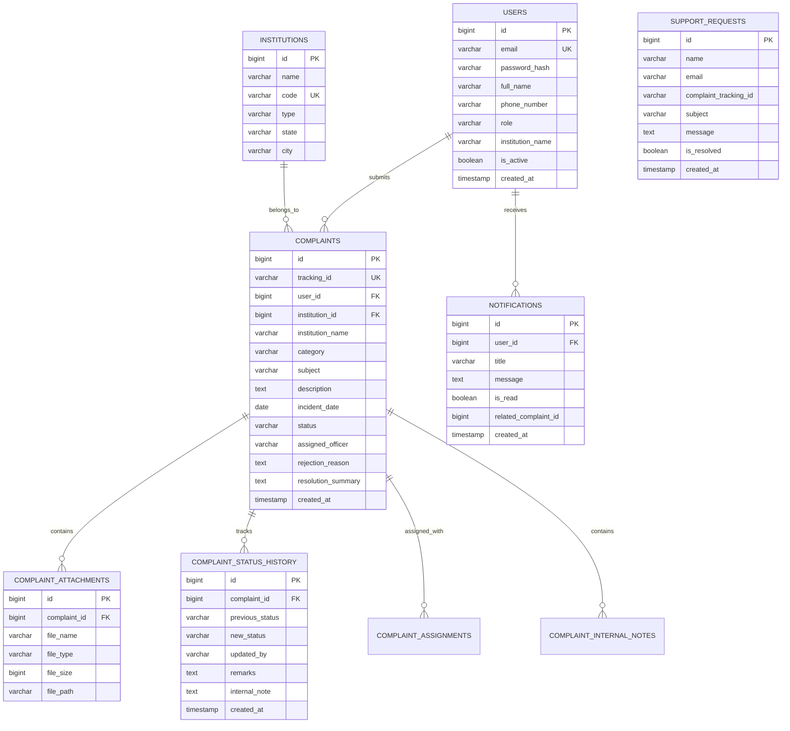

# EduVision – Database Schema Documentation

This document describes the relational database architecture for the **EduVision Complaint Monitoring Portal**.

## 1. Entity Relationship Diagram

## 2. Table Specifications

### 2.1 `users`
- `id` (BIGINT, Primary Key, Auto Increment)
- `email` (VARCHAR(191), Unique, Indexed)
- `password_hash` (VARCHAR(255), BCrypt 60-char hash)
- `full_name` (VARCHAR(120), Not Null)
- `phone_number` (VARCHAR(25))
- `role` (VARCHAR(30): `STUDENT`, `TEACHER`, `HOD`, `INSTITUTION_HEAD`, `AICTE_OFFICER`, `ADMIN`)
- `institution_name` (VARCHAR(255))
- `avatar_url` (VARCHAR(500))
- `is_active` (BOOLEAN, Default `TRUE`)
- `created_at`, `updated_at` (TIMESTAMP)

### 2.2 `complaints`
- `id` (BIGINT, Primary Key, Auto Increment)
- `tracking_id` (VARCHAR(50), Unique, Indexed, format: `CMP-YYYY-XXXXXX`)
- `user_id` (BIGINT, Foreign Key referencing `users(id)`)
- `institution_id` (BIGINT, Foreign Key referencing `institutions(id)`)
- `institution_name` (VARCHAR(255), Not Null)
- `category` (VARCHAR(80), Academic Issues, Infrastructure, Fee Related, etc.)
- `subject` (VARCHAR(200), Brief summary)
- `description` (TEXT, Detailed grievance narrative)
- `status` (`SUBMITTED`, `UNDER_REVIEW`, `IN_PROCESS`, `RESOLVED`, `REJECTED`, `CLOSED`)
- `assigned_officer` (VARCHAR(120))
- `rejection_reason` (TEXT, Mandatory when status is `REJECTED`)
- `resolution_summary` (TEXT, Populated when status is `RESOLVED`)

### 2.3 `complaint_status_history`
- Stores an immutable audit trail of every status transition.
- Separate public `remarks` from confidential `internal_note`.

## 3. Timezone Strategy
All server timestamps are persisted in **UTC** in database `TIMESTAMP` columns and mapped to ISO-8601 strings in REST API responses (`yyyy-MM-dd'T'HH:mm:ss`). Frontend code formats these according to the user's local timezone (e.g. `24 Oct 2026, 10:42 AM`).
