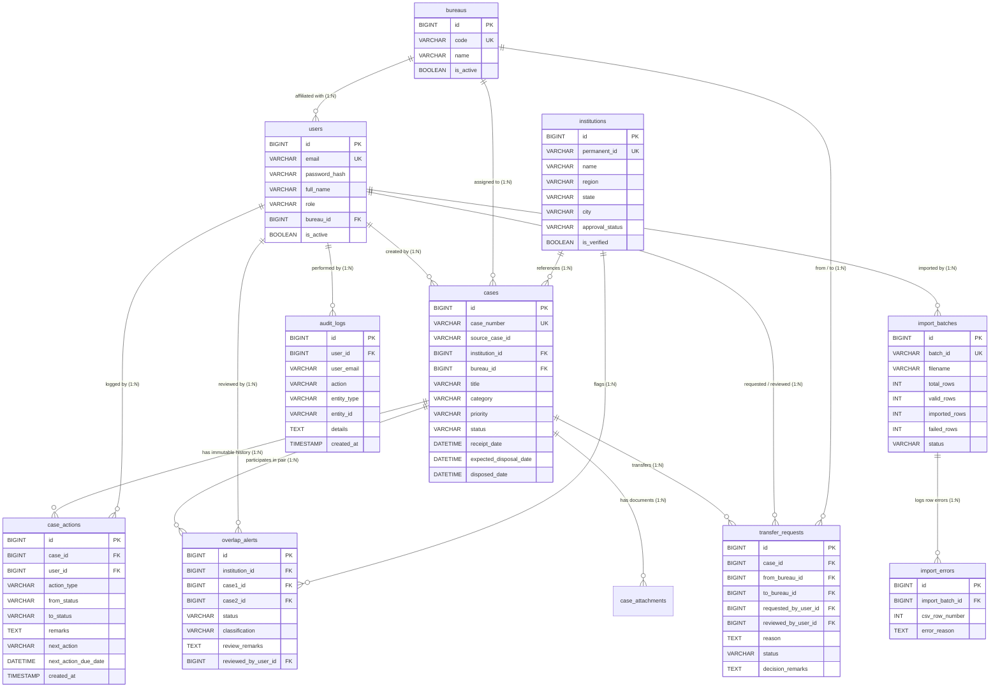

# AICTE Integrated Institution Complaint Monitoring & Status Dashboard
## Relational Database Design & ER Schema (Third Normal Form - 3NF)
**Target: MySQL 8.0+ | Database Name: `aicte_complaints`**

---

### 1. Entity-Relationship (ER) Diagram

---

### 2. Normalization & Integrity Principles

1. **Third Normal Form (3NF) Compliance:**
   - Every non-key attribute depends strictly on the primary key, whole key, and nothing but the key.
   - Institution and Bureau metadata are normalized into dedicated reference tables (`institutions`, `bureaus`), preventing data anomalies across case records.

2. **Immutable Append-Only Action History (`case_actions`):**
   - Case records in the `cases` table reflect current status and deadlines.
   - Any status transition or official comment appends a non-destructive row to `case_actions` with author credential, old status, new status, and timestamp. Rows in `case_actions` are never updated or deleted.

3. **Case Transfer Integrity Rule:**
   - When a case is transferred from one Bureau to another, its unique `case_number` is strictly preserved.
   - The transfer is logged in `transfer_requests` and appended to `case_actions`.
   - The original case file is never duplicated or prematurely closed.

4. **Rules-Based Cross-Bureau Overlap Engine (`overlap_alerts`):**
   - Flags active complaints (`status IN ('RECEIVED', 'UNDER_PROCESS')`) sharing the same verified `institution_id` across distinct `bureau_id`s.
   - An alert is created with status `DETECTED`.
   - Distinct case records are never merged; human officers classify alerts as `RELATED`, `UNRELATED`, or `REQUIRES_COORDINATION`.
